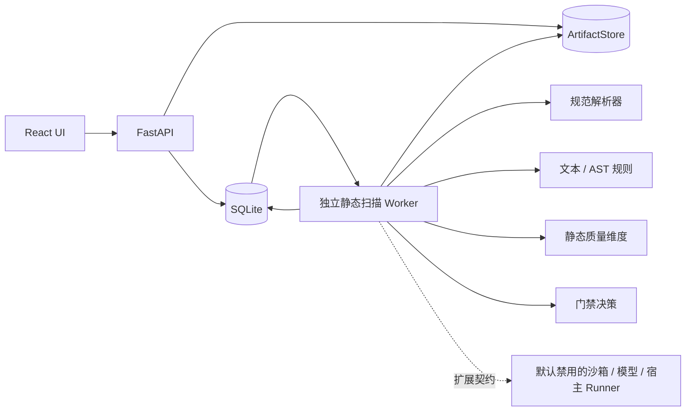

# 架构

React / TypeScript / Vite 前端通过同源 API 访问 FastAPI。SQLAlchemy + Alembic 管理 SQLite 数据与迁移；API 将扫描任务写入 SQLite，由独立 Worker 处理。内容寻址的本地 ArtifactStore 保存工件，文件不作为 Python 模块导入。

SQLite 中的待扫描任务是唯一队列实现，独立 Worker 轮询，不把扫描搬进 Web 请求或启动后台线程伪装 Worker。这是本地启动与验证的正式运行路径，无需 Docker、容器、外部数据库或队列服务。

API 创建 `QUEUED` 记录后返回，Worker 通过原子领取与租约转为 `RUNNING`，然后保存阶段状态、findings、质量维度和 JSON 报告。重试使用相同 scan_id，持久化前校验租约 token，避免过期 Worker 覆盖新结果；队列恢复和租约到期保留明确错误状态。

上传流在反向代理、ASGI 请求体和 ZIP 读取层均有限额。归档不按不可信路径落盘；经安全路径校验后在内存读取并编目，原始 ZIP 以内容 hash 保存到平台对象存储。Worker 重新核验工件 hash 后扫描，报告用独立内容 key 保存。

领域接口不依赖第三方扫描器 CLI 输出。所有阶段独立记录状态、原因和耗时。报告记录规则版本、策略版本和内容 hash；后续版本比较根据稳定 fingerprint 比较 findings。

安全规则与质量指标分开。未运行功能正确性、稳定性评测时完整质量分为空；静态子分只覆盖已评测维度。

报告记录策略快照、规则集 hash、扫描器源代码 hash 和资源限制；不同规则 / 策略 / 扫描器或覆盖下比较会显示可比性提示。主匹配使用脱敏证据稳定指纹，保守的次级匹配标明证据变化。

测试使用临时 SQLite 数据库和工件目录；CI 不依赖任何外部数据库、缓存或队列服务。
